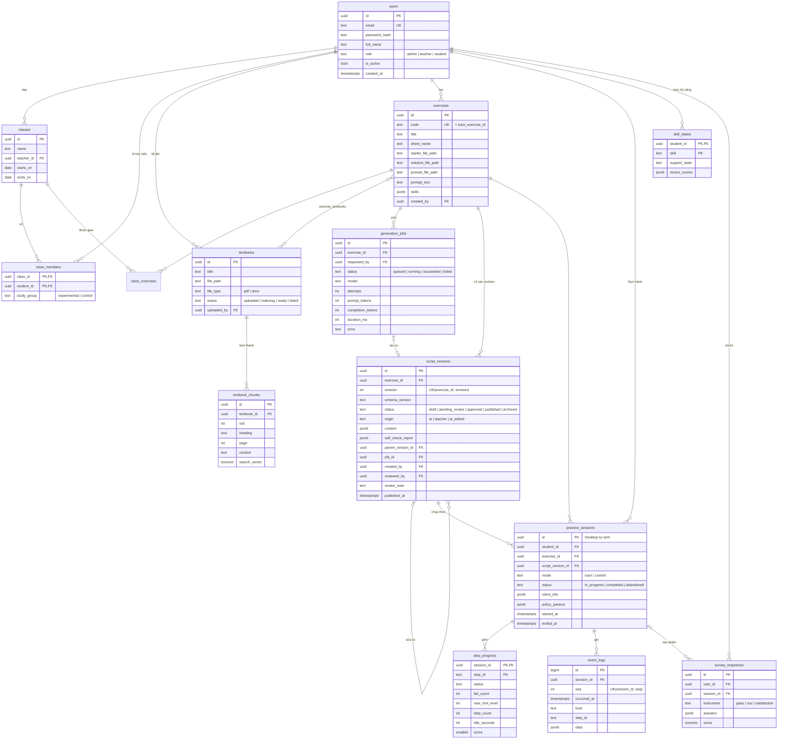

# Thiết kế cơ sở dữ liệu

**Task:** T3.6 · **Báo cáo:** mục 3.4 · **Trạng thái:** v1, chờ GVHD rà soát (T3.8)
**CSDL:** PostgreSQL 16 ([kien-truc.md](kien-truc.md) mục 2) · **Code:** `apps/backend/src/tutor_backend/models/` (mỗi bảng một file), migration Alembic (GĐ5)

## 1. Sơ đồ ERD

Mọi bảng có `created_at` (và `updated_at` khi có sửa); sơ đồ lược bớt để dễ đọc.

## 2. Mô tả các bảng

### 2.1. Người dùng, lớp

| Bảng | Mục đích | Ghi chú |
|---|---|---|
| `users` | Tài khoản cả 3 vai trò | `email` duy nhất (không phân biệt hoa thường: lưu chữ thường). `password_hash`: argon2 |
| `classes` | Lớp học, có giảng viên phụ trách | |
| `class_members` | Học viên thuộc lớp và **nhóm thực nghiệm** | `study_group` quyết định Desktop chạy chế độ `tutor` hay `control` (FR-D15) |
| `class_exercises` | Bài được giao cho lớp | `due_at` tùy chọn |

### 2.2. Học liệu

| Bảng | Mục đích | Ghi chú |
|---|---|---|
| `textbooks` | Giáo trình tải lên | File nằm trong kho file; `status` cho Web hiện tiến trình lập chỉ mục |
| `textbook_chunks` | Đoạn giáo trình đã tách cho RAG | `search_vector` (tsvector, chỉ mục GIN) cho tìm toàn văn. Cột `embedding` thêm sau khi chọn nhà cung cấp (T5.4) |
| `exercises` | Bài tập | `code` là **mã bài** nhúng vào file đề khi phát hành, duy nhất, dạng `^[a-z0-9][a-z0-9-]{2,63}$` (như lược đồ kịch bản) |
| `exercise_textbooks` | Bài ↔ giáo trình liên quan (nhiều-nhiều) | Giới hạn phạm vi tìm đoạn giáo trình khi sinh |

### 2.3. Kịch bản

| Bảng | Mục đích | Ghi chú |
|---|---|---|
| `generation_jobs` | Mỗi lần bấm "Sinh kịch bản" | Lưu mô hình, số lần thử, token, thời gian: dữ liệu cho đánh giá kỹ thuật (đề cương 5.2) |
| `script_versions` | **Mỗi revision là một dòng, không sửa đè** | `content` là toàn bộ kịch bản JSON (đã qua lược đồ). `parent_version_id`: revision được sửa từ revision nào → so được AI sinh với giảng viên sửa. `self_check_report`: kết quả tự kiểm 3 tầng |

Ràng buộc của `script_versions`:
- `UNIQUE (exercise_id, revision)`; `revision` tăng dần theo bài.
- **Chỉ một bản `published` mỗi bài**: chỉ mục duy nhất có điều kiện `UNIQUE (exercise_id) WHERE status = 'published'`.
- Chuyển trạng thái theo sơ đồ ở [luoc-do-kich-ban.md](luoc-do-kich-ban.md) mục 4.2, kiểm ở tầng `services/` (không cho `draft → published` trực tiếp).
- `content` của bản đã `approved` / `published` **không được sửa**; muốn sửa thì tạo revision mới.

### 2.4. Thực hành, nhật ký, thực nghiệm

| Bảng | Mục đích | Ghi chú |
|---|---|---|
| `practice_sessions` | Một lần học viên làm một bài | `id` **do Desktop sinh** (UUID) để tạo phiên được cả khi mất mạng; gửi lên sau. `script_version_id` cố định cả phiên. `client_info`: phiên bản Excel, ngôn ngữ Office, DPI, Windows. `policy_params`: tham số luật gợi ý của phiên |
| `step_progress` | Kết quả từng bước trong phiên | Chính là các biến của [luật gợi ý](luat-goi-y.md) mục 2 lúc bước kết thúc; `score` là điểm độc lập (mục 5) |
| `event_logs` | Nhật ký chi tiết: sự kiện quan sát quan trọng, tín hiệu, luật đã áp dụng, gợi ý đã hiện | `UNIQUE (session_id, seq)`: Desktop gửi lại một lô bị lỗi mạng thì không bị ghi trùng (idempotent). Chỉ mục `(session_id, occurred_at)` |
| `skill_states` | Mức hỗ trợ theo kỹ năng của từng học viên | Backend tính lại khi nhận `step_progress`; Desktop tải về khi bắt đầu phiên |
| `survey_responses` | Phiếu Paas (sau mỗi bài), SUS (cuối đợt), hài lòng | `score` tính sẵn (SUS 0–100) để xuất dữ liệu nhanh |

## 3. Ước lượng dung lượng

Một đợt thực nghiệm: ~60 học viên × ~10 bài × ~150 sự kiện nhật ký mỗi phiên ≈ **90.000 dòng `event_logs`**, mỗi dòng < 1 KB → < 100 MB. Không cần phân vùng bảng hay cơ chế lưu trữ riêng.

## 4. Quyền riêng tư và xuất dữ liệu

- Chỉ lưu những gì đề cương cho phép (11.2): tài khoản, tiến độ, nhật ký thao tác **trên Excel**. `event_logs.data` **không** lưu nội dung ô ngoài vùng của bài.
- Xuất dữ liệu nghiên cứu (FR-W15) thay `user_id` bằng mã ẩn danh ổn định (băm có muối), bỏ email, họ tên.
- Xóa học viên → xóa dây chuyền phiên, nhật ký, phiếu của học viên đó.

## 5. Ánh xạ sang code

| Bảng | Model | Service chính |
|---|---|---|
| `users`, `classes`, `class_members`, `class_exercises` | `models/user.py`, `models/class_.py`… | `services/account_service.py`, `class_service.py` |
| `textbooks`, `textbook_chunks`, `exercise_textbooks` | `models/textbook.py` | `services/material_service.py`, `ai/rag.py` |
| `exercises` | `models/exercise.py` | `services/exercise_service.py` |
| `generation_jobs`, `script_versions` | `models/generation_job.py`, `models/script_version.py` | `services/script_service.py`, `services/publish_service.py` |
| `practice_sessions`, `step_progress`, `event_logs`, `skill_states`, `survey_responses` | `models/practice.py`… | `services/progress_service.py`, `services/report_service.py` |
