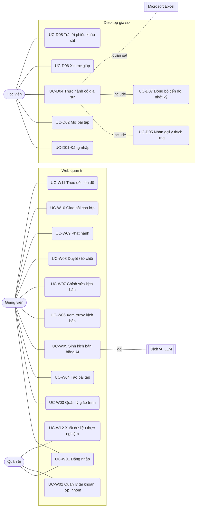

# Đặc tả yêu cầu

**Task:** T3.1 · **Báo cáo:** mục 3.3 · **Trạng thái:** v1, chờ GVHD rà soát (T3.8)
**Nguồn:** đề cương (mục tiêu cụ thể, phạm vi 11.2, sản phẩm), kết quả GĐ1–GĐ2. **Chưa đối chiếu** với bộ tiêu chí kiểm tra và quy tắc phản hồi của GĐ1 khảo sát (T0.5 chưa xác nhận).

Mức ưu tiên: **P1** bắt buộc cho thực nghiệm · **P2** nên có · **P3** làm nếu còn thời gian.

## 1. Tác nhân

| Tác nhân | Mô tả | Dùng |
|---|---|---|
| **Giảng viên** | Giảng viên trung tâm tin học: đưa học liệu, duyệt và phát hành kịch bản, theo dõi học viên | Web quản trị |
| **Học viên** | Người học thực hành Excel | Desktop gia sư |
| **Quản trị hệ thống** | Tạo tài khoản, lớp, chia nhóm thực nghiệm; xuất dữ liệu nghiên cứu (nhóm đề tài) | Web quản trị |
| *Dịch vụ LLM* | Mô hình ngôn ngữ lớn qua API (Inception Labs `mercury-3`) — hệ thống ngoài | Backend gọi |
| *Microsoft Excel* | Excel bản cài trên máy học viên — hệ thống ngoài | Desktop quan sát |

## 2. Ca sử dụng

### Đặc tả các ca sử dụng chính

**UC-W05 — Sinh kịch bản bằng AI** (P1)
- *Tiền điều kiện:* bài tập có file đề và file đáp án (cùng bố cục); có thể có đề bài PDF và giáo trình liên kết.
- *Luồng chính:* (1) Giảng viên bấm "Sinh kịch bản". (2) Backend so sánh file đề với đáp án → danh sách thay đổi kèm ngữ cảnh "giữ nguyên". (3) Tìm đoạn giáo trình liên quan (RAG). (4) Gọi LLM sinh kịch bản theo lược đồ. (5) Kiểm 3 tầng: lược đồ, tham chiếu chéo, tự kiểm trên file (mỗi điều kiện đạt trên đáp án và không đạt trên đề; độ phủ diff; số liệu và địa chỉ ô trong chữ gợi ý có thật). (6) Không đạt thì gửi lỗi cho LLM sửa, tối đa N lần. (7) Lưu bản nháp kèm báo cáo tự kiểm. (8) Web hiện trạng thái tiến trình rồi mở bản nháp.
- *Luồng phụ:* LLM lỗi hoặc hết lượt sửa → bản nháp vẫn lưu, các mục chưa đạt được **đánh dấu đỏ** cho giảng viên.
- *Hậu điều kiện:* có một `revision` mới, trạng thái `draft`, nguồn `ai`.

**UC-W08/W09 — Duyệt và phát hành** (P1)
- Giảng viên xem từng bước (thẻ yêu cầu, điều kiện, 4 cấp gợi ý, báo cáo tự kiểm), sửa nếu cần (UC-W07, tạo revision mới), rồi **duyệt**. Phát hành: Backend nhúng mã bài vào file đề, bản cũ (nếu có) chuyển lưu trữ. Giảng viên tải file đề đã nhúng mã để phát cho học viên.
- *Ràng buộc:* **không có đường phát hành nào bỏ qua bước duyệt của giảng viên** (đề cương 11.2: mọi kịch bản phải được kiểm duyệt).

**UC-D04 — Thực hành có gia sư** (P1)
- *Tiền điều kiện:* học viên đã đăng nhập Desktop, mở file đề (có mã bài) trong Excel.
- *Luồng chính:* (1) Desktop nhận ra mã bài, tải kịch bản đã phát hành (hoặc dùng bản đã lưu). (2) Hiện thẻ yêu cầu bước 1. (3) Học viên tự làm; Desktop quan sát (COM, UIA), kiểm chứng tất định theo điều kiện của bước. (4) Khi có tín hiệu, áp dụng [luật gợi ý](luat-goi-y.md) (UC-D05). (5) Bước đạt → chuyển bước. (6) Hết bước → màn hình hoàn thành, đối chiếu tiêu chí của giảng viên. (7) Tiến độ và nhật ký đồng bộ về Backend (UC-D07).
- *Luồng phụ:* mất mạng → dùng bản đã lưu, nhật ký xếp hàng chờ gửi. Học viên đóng Excel giữa chừng → lưu tiến độ, lần sau tiếp tục từ bước đang làm.

## 3. Yêu cầu chức năng

### 3.1. Web quản trị + Backend

| Mã | Yêu cầu | Ưu tiên | UC |
|---|---|---|---|
| FR-W01 | Đăng nhập bằng email + mật khẩu; phân quyền giảng viên / quản trị | P1 | W01 |
| FR-W02 | Quản trị tạo tài khoản (nhập danh sách CSV), lớp, chia học viên vào nhóm thực nghiệm / đối chứng | P1 | W02 |
| FR-W03 | Tải lên giáo trình PDF, DOCX; hệ thống tách đoạn, lập chỉ mục cho RAG; hiện trạng thái xử lý | P1 | W03 |
| FR-W04 | Tạo bài tập: tên, file đề `.xlsx`, file đáp án `.xlsx`, đề bài (PDF/ảnh/văn bản, tùy chọn), sheet làm bài, giáo trình liên quan | P1 | W04 |
| FR-W05 | Kiểm tra file khi tải lên: đúng `.xlsx`, file đáp án có giá trị đã tính, đề và đáp án **cùng bố cục** (cảnh báo nếu lệch) | P1 | W04 |
| FR-W06 | Sinh kịch bản bằng AI chạy nền, có trạng thái tiến trình; lưu kèm báo cáo tự kiểm, mô hình, số token, thời gian | P1 | W05 |
| FR-W07 | Xem kịch bản theo từng bước; đánh dấu mục không qua tự kiểm; xem đoạn giáo trình được trích | P1 | W06 |
| FR-W08 | Sửa kịch bản bằng biểu mẫu (không bắt sửa JSON thô); kiểm theo lược đồ khi lưu; mỗi lần lưu là một revision | P1 | W07 |
| FR-W09 | Xem khác biệt giữa hai revision (AI sinh vs giảng viên sửa) | P2 | W07 |
| FR-W10 | Gửi duyệt, duyệt, từ chối kèm góp ý; ghi người và thời điểm | P1 | W08 |
| FR-W11 | Phát hành: nhúng mã bài vào file đề, cho tải file đề đã nhúng; mỗi bài tối đa một bản phát hành | P1 | W09 |
| FR-W12 | Giao bài cho lớp, có thời hạn | P2 | W10 |
| FR-W13 | Bảng tiến độ: theo lớp × bài × bước (hoàn thành, thời gian, số lần sai, cấp gợi ý cao nhất) | P1 | W11 |
| FR-W14 | Thống kê "bước hay vướng" và "cấp gợi ý hay dùng" theo bài | P2 | W11 |
| FR-W15 | Xuất dữ liệu thực nghiệm (CSV): tiến độ, nhật ký, phiếu Paas, SUS, theo nhóm | P1 | W12 |
| FR-W16 | Sinh lại kịch bản (giữ bản cũ) | P2 | W05 |

### 3.2. Desktop gia sư

| Mã | Yêu cầu | Ưu tiên | UC |
|---|---|---|---|
| FR-D01 | Đăng nhập; nhớ phiên đăng nhập trên máy | P1 | D01 |
| FR-D02 | Tự nhận ra bài khi học viên mở file đề có mã bài (thuộc tính tùy chỉnh `tutor_exercise_id`) | P1 | D02 |
| FR-D03 | Tải kịch bản đã phát hành, kiểm theo lược đồ, lưu bản cục bộ; dùng bản đã lưu khi mất mạng | P1 | D02 |
| FR-D04 | Giám sát Excel: thay đổi ô, vùng chọn, sheet, hộp thoại đang mở, trạng thái bận, in ra PDF | P1 | D04 |
| FR-D05 | Kiểm chứng tất định từng bước theo điều kiện trong kịch bản, dùng chung `excel_core` với Backend | P1 | D04 |
| FR-D06 | Cửa sổ gia sư: thẻ yêu cầu bước hiện tại, tiến độ các bước, khu vực gợi ý, nút trợ giúp | P1 | D04 |
| FR-D07 | Gợi ý 4 cấp theo luật thích ứng ([luat-goi-y.md](luat-goi-y.md)) | P1 | D05 |
| FR-D08 | Overlay chỉ vị trí vùng ô và nút Ribbon ngay trên Excel; đúng khi cuộn, phóng to, di chuyển, nhiều màn hình | P1 | D05 |
| FR-D09 | Phản hồi riêng theo mã lỗi; phản hồi **ngay** khi phá dữ liệu (gợi ý Ctrl+Z) | P1 | D05 |
| FR-D10 | Nút trợ giúp: tăng một cấp gợi ý | P1 | D06 |
| FR-D11 | Ghi nhật ký thực hành; gửi về Backend theo lô, xếp hàng khi mất mạng | P1 | D07 |
| FR-D12 | Lưu tiến độ, mở lại bài thì tiếp tục từ bước đang làm | P2 | D04 |
| FR-D13 | Phiếu tự đánh giá tải nhận thức (Paas, 9 mức) sau mỗi bài; phiếu SUS cuối đợt | P1 | D08 |
| FR-D14 | Mascot (nhân vật) đi kèm thông điệp | P3 | D05 |
| FR-D15 | Chế độ "đối chứng": học viên nhóm đối chứng chỉ được ghi nhật ký, không có gợi ý (để so sánh công bằng) | P2 | D04 |

## 4. Yêu cầu phi chức năng

| Mã | Nhóm | Yêu cầu | Đo bằng | Cơ sở |
|---|---|---|---|---|
| NFR-01 | Hiệu năng | Từ khi ô thay đổi tới khi có kết quả kiểm chứng: **≤ 300 ms** (trung vị), ≤ 1 s (p95) | Nhật ký thời gian ở Desktop (T8.x) | T2.1, T2.2: đọc vùng < 5 ms, sự kiện trễ < 25 ms |
| NFR-02 | Hiệu năng | Overlay cập nhật vị trí sau cuộn/phóng to/di chuyển: ≤ 300 ms | Đo thủ công + nhật ký | T2.5 |
| NFR-03 | Hiệu năng | Sinh kịch bản một bài: **≤ 60 s** kể cả tự kiểm và sửa lại; có trạng thái tiến trình | Nhật ký Backend | T2.6: LLM 3–13 s/lần |
| NFR-04 | Độ chính xác | Nhận diện đúng trạng thái bước (đạt/chưa đạt) **≥ 95%**; báo sai (học viên làm đúng mà báo sai) **≤ 5%** | Bộ ca kiểm thử thao tác (T8.x) | Đề cương 5.2 |
| NFR-05 | Độ ổn định | Desktop chạy liên tục **≥ 60 phút** thao tác tự do không crash; chịu được Excel bận | Kiểm thử chạy bền | T2.2: 10 phút, 0 crash |
| NFR-06 | Không xâm lấn | Desktop **không bao giờ sửa** workbook của học viên; không giành focus của Excel; không đóng Excel của học viên | Review code + kiểm thử | Quy tắc code 2.3 |
| NFR-07 | Tương thích | Windows 10/11; Excel 2016 trở lên (ưu tiên Microsoft 365); giao diện Office **tiếng Việt và tiếng Anh**; định dạng vùng vi-VN và en-US; tỉ lệ màn hình 100–200%; nhiều màn hình | Kiểm thử trên máy trung tâm (T9.3) | Đề cương 11.2; T2.4, T2.5 |
| NFR-08 | Tương thích | Web quản trị chạy trên Chrome, Edge, Firefox bản hiện hành | Kiểm thử thủ công | Đề cương 11.2 |
| NFR-09 | Ngoại tuyến | Desktop hướng dẫn được khi mất mạng nếu đã tải kịch bản; không mất nhật ký | Kiểm thử ngắt mạng | Đề cương mục tiêu 5 |
| NFR-10 | Bảo mật | Mật khẩu băm (bcrypt/argon2); token có hạn; HTTPS khi triển khai; phân quyền theo vai trò ở mọi API; API key LLM chỉ ở Backend (`.env`) | Review + test API | Quy tắc code mục 5 |
| NFR-11 | Quyền riêng tư | Chỉ thu tài khoản, tiến độ, nhật ký thao tác trên Excel (đề cương 11.2). **Không chụp màn hình**, không đọc cửa sổ khác ngoài Excel; dữ liệu xuất cho nghiên cứu được ẩn danh | Review | Đề cương 11.2 |
| NFR-12 | Khả dụng | Điểm SUS ≥ **68** (mức trung bình chuẩn); tải nhận thức (Paas) nhóm thực nghiệm không cao hơn đối chứng | Phiếu ở thực nghiệm | Đề cương 5.3 |
| NFR-13 | Đúng đắn của AI | Kịch bản AI sinh **không** được phát hành nếu chưa qua tự kiểm và chưa được giảng viên duyệt; mọi gợi ý không chứa số liệu hay địa chỉ ô không có thật | Kiểm 3 tầng + quy trình duyệt | T2.6; đề cương 11.3 |
| NFR-14 | Bảo trì | CI chạy định dạng, kiểm tra code, test cho mọi Pull Request; lược đồ có phiên bản; prompt nằm trong file riêng | GitHub Actions | Quy tắc code |
| NFR-15 | Triển khai | Desktop đóng gói thành một bộ cài `.exe`, không cần cài Python; Backend + Web triển khai trên một máy chủ của trung tâm (quy mô lớp học) | Cài thử trên máy trắng | Đề cương: sản phẩm; 11.2 |

## 5. Ràng buộc

1. **Desktop không gọi LLM**; AI chỉ ở khâu sinh kịch bản trên Backend (đề cương 11.2; quyết định của nhóm 06/11/2026).
2. Không huấn luyện mô hình mới; dùng LLM qua API.
3. Không hỗ trợ VBA/Macro, Power Query, Power Pivot; không hỗ trợ Excel web, Excel macOS, Google Sheets, LibreOffice.
4. Ngôn ngữ giao diện: tiếng Việt.
5. Quy mô: một lớp học (khoảng 30–60 học viên đồng thời), chưa tối ưu cho nhiều trung tâm (đề cương 11.2).

## 6. Truy vết yêu cầu → đề cương → giai đoạn

| Mục tiêu cụ thể trong đề cương | Yêu cầu | Giai đoạn làm |
|---|---|---|
| Bộ tiêu chí kiểm tra và quy tắc phản hồi | Danh mục điều kiện, `feedback`, FR-D09 | GĐ1, GĐ3 |
| Công cụ cập nhật học liệu; RAG + tác tử sinh và kiểm duyệt kịch bản JSON | FR-W03 – FR-W11, FR-W16, NFR-03, NFR-13 | GĐ5, GĐ6 |
| Bộ giám sát (COM, Win32, MSAA, UIA) | FR-D02, FR-D04, FR-D08, NFR-01, NFR-05, NFR-07 | GĐ4, GĐ7 |
| Giao diện người học (cửa sổ gia sư, mascot, overlay); Teaching Agent | FR-D05 – FR-D10, FR-D14 | GĐ7 |
| Web + Desktop nối Backend qua REST/JSON; Desktop lưu bản cục bộ, gửi tiến độ và nhật ký | FR-D03, FR-D11, NFR-09, [openapi.yaml](openapi.yaml) | GĐ5 – GĐ8 |
| Đánh giá kỹ thuật và thực nghiệm sư phạm | FR-W13 – FR-W15, FR-D13, FR-D15, NFR-04, NFR-12 | GĐ8 – GĐ10 |
