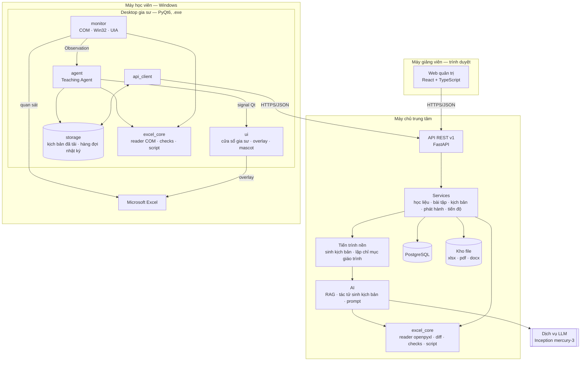
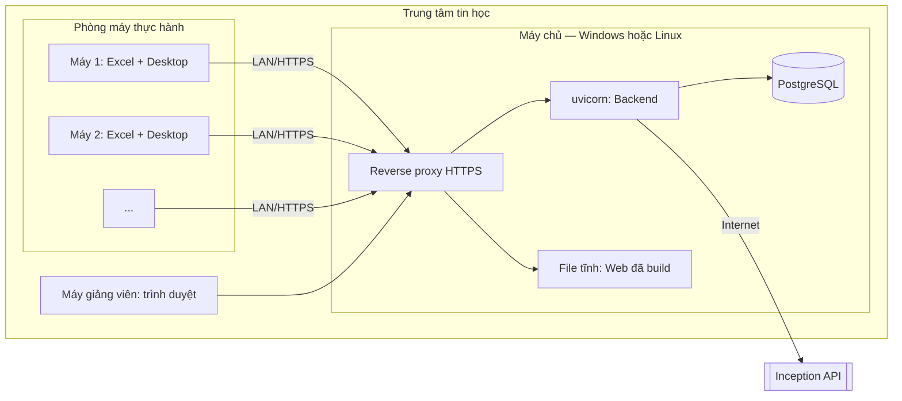
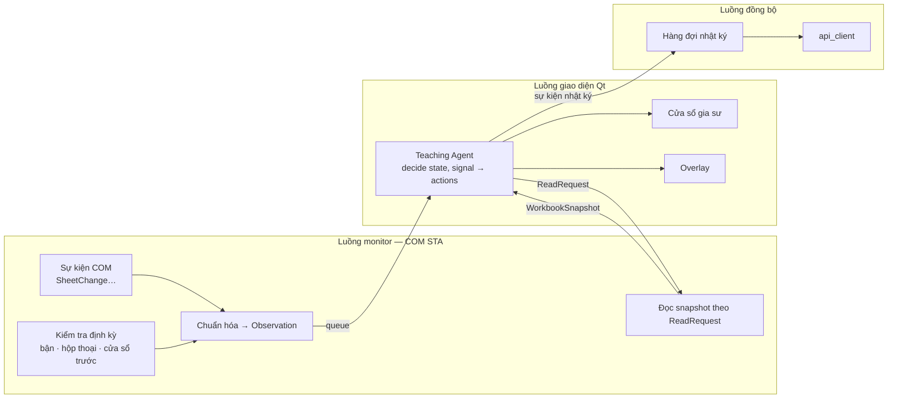
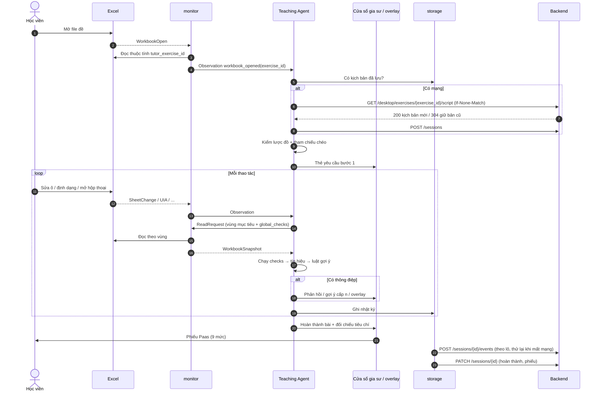

# Kiến trúc tổng thể

**Task:** T3.5 · **Báo cáo:** mục 3.4 · **Trạng thái:** v1, chờ GVHD rà soát (T3.8)
**Liên quan:** [yêu cầu](dac-ta-yeu-cau.md) · [lược đồ kịch bản](luoc-do-kich-ban.md) · [snapshot](snapshot.md) · [luật gợi ý](luat-goi-y.md) · [CSDL](csdl.md) · [API](openapi.yaml) · [cấu trúc thư mục](../quy-uoc/cau-truc-thu-muc.md)

## 1. Sơ đồ thành phần



**Quy tắc phụ thuộc** (đã chốt ở [cau-truc-thu-muc.md](../quy-uoc/cau-truc-thu-muc.md) mục 3): `excel_core` không biết ai dùng nó; các app chỉ nói chuyện qua REST; **Desktop không gọi LLM**; trong Desktop chỉ `monitor/` nói chuyện với Excel, `ui/` nhận dữ liệu qua signal.

## 2. Lựa chọn công nghệ

| Phần | Chọn | Lý do / ghi chú |
|---|---|---|
| Backend | FastAPI, SQLAlchemy 2, Alembic, Pydantic | Đã cam kết trong đề cương; sinh OpenAPI tự động cho Web |
| CSDL | **PostgreSQL 16** khi triển khai; SQLite cho test nhanh | Quy mô lớp học; JSON (`jsonb`) cho nội dung kịch bản và nhật ký; tìm kiếm toàn văn tiếng Việt cho RAG |
| Tìm đoạn giáo trình (RAG) | **Bước 1:** tìm toàn văn (PostgreSQL full-text / BM25). **Bước 2:** thêm embedding khi chọn xong nhà cung cấp (T5.4) | Inception không có API embedding (T0.4). Giáo trình một khóa chỉ vài trăm đoạn, tìm toàn văn đã đủ để bắt đầu; so sánh hai cách ở T5.8 |
| Tiến trình nền | Hàng đợi trong tiến trình (thread pool) + bảng `generation_jobs` | Vài giảng viên sinh cùng lúc, không cần Celery/Redis. Web hỏi trạng thái định kỳ |
| Lưu file | Thư mục trên máy chủ (`STORAGE_DIR`), tên file theo id | Đơn giản; đường dẫn lưu trong CSDL |
| Xác thực | Mật khẩu băm argon2 + **JWT** (access 60 phút, refresh 14 ngày) | Dùng chung cho Web và Desktop |
| Web | React + TypeScript (Vite), kiểu dữ liệu sinh từ `openapi.yaml` | Đề cương; quy tắc code mục 3 |
| Desktop | Python 3.14, PyQt6, pywin32, uiautomation; PyInstaller | Đã thử ở GĐ0, GĐ2 |
| LLM | Inception `mercury-3` (dự phòng `mercury-2`), API tương thích OpenAI, structured output `json_schema` | T0.4, T2.6 |

## 3. Triển khai



Chỉ máy chủ cần Internet (gọi LLM). Phòng máy chỉ cần nối được máy chủ; mất kết nối thì Desktop vẫn hướng dẫn bằng kịch bản đã tải (NFR-09).

## 4. Bên trong Desktop: các luồng



- **Mọi lệnh COM chạy trên luồng monitor** (quy tắc code 2.3 mục 1), có vòng `PumpWaitingMessages` để nhận sự kiện (T2.2).
- **Teaching Agent là hàm thuần** `decide(state, signal) → actions` ([luật gợi ý](luat-goi-y.md) mục 8), chạy ở luồng giao diện; mọi thứ chậm (COM, mạng) ở luồng khác → giao diện không bao giờ treo.
- Tọa độ overlay: monitor tính (COM khi DPI cửa sổ = DPI hệ thống, ngược lại UIA, T2.5) rồi gửi cho `ui/`.

## 5. Luồng "sinh – duyệt – phát hành"

```mermaid
sequenceDiagram
    autonumber
    actor GV as Giảng viên
    participant W as Web
    participant B as Backend
    participant J as Tiến trình nền
    participant C as excel_core
    participant L as LLM
    participant D as CSDL / kho file

    GV->>W: Tạo bài tập (file đề, đáp án, đề bài, giáo trình)
    W->>B: POST /exercises (multipart)
    B->>C: Đọc 2 file, kiểm cùng bố cục
    B->>D: Lưu bài tập + file
    GV->>W: Bấm "Sinh kịch bản"
    W->>B: POST /exercises/{id}/generation-jobs
    B->>D: Tạo job (queued)
    B-->>W: 202 + job_id
    B->>J: Chạy job
    J->>C: diff(đề, đáp án) + ngữ cảnh "giữ nguyên" + tiêu đề cột
    J->>D: Tìm đoạn giáo trình liên quan (RAG)
    loop Tối đa 3 lần
        J->>L: Prompt + diff + đoạn giáo trình + lược đồ (structured output)
        L-->>J: Kịch bản JSON
        J->>C: Tầng 1–2: lược đồ, tham chiếu chéo
        J->>C: Tầng 3: điều kiện đạt trên đáp án, không đạt trên đề; độ phủ diff; số và địa chỉ trong gợi ý
        alt Đạt hết
            J->>J: Dừng vòng lặp
        else Còn lỗi
            J->>J: Đưa danh sách lỗi vào prompt sửa
        end
    end
    J->>D: Lưu revision (draft, origin=ai) + báo cáo tự kiểm
    loop Mỗi 2 giây
        W->>B: GET /generation-jobs/{job_id}
    end
    B-->>W: succeeded + script_version_id
    GV->>W: Xem từng bước, sửa nếu cần
    W->>B: POST /exercises/{id}/scripts (revision mới, ai_edited)
    GV->>W: Gửi duyệt → Duyệt
    W->>B: POST /scripts/{vid}/submit → /approve
    GV->>W: Phát hành
    W->>B: POST /scripts/{vid}/publish
    B->>C: Nhúng tutor_exercise_id vào file đề (openpyxl)
    B->>D: Bản cũ → archived; bản này → published
    GV->>W: Tải file đề đã nhúng mã, phát cho học viên
```

## 6. Luồng "học viên thực hành"



## 7. Các quyết định kiến trúc

| # | Quyết định | Phương án đã cân nhắc | Lý do chọn |
|---|---|---|---|
| A1 | AI chỉ ở Backend, lúc sinh kịch bản; Desktop chạy kịch bản tất định | LLM chạy trực tiếp khi học viên làm | Nhanh, nhất quán, giải thích được, không tốn tiền theo số học viên, chạy được khi mất mạng (đề cương 11.3) |
| A2 | Diff đề ↔ đáp án làm "xương sống" cho AI | Cho AI đọc nguyên file | T2.6: độ phủ 100%; T0.4: chỉ đọc đề thì bỏ sót bước |
| A3 | Một `excel_core` cho cả hai phía | Mỗi bên tự viết điều kiện | Backend tự kiểm và Desktop chấm phải cho cùng kết quả |
| A4 | Kịch bản lưu nguyên khối JSON theo revision | Tách bước, gợi ý thành nhiều bảng | Kịch bản là đơn vị duyệt và phát hành; lược đồ JSON đã kiểm cấu trúc; dễ so sánh revision |
| A5 | Nhận bài qua thuộc tính tùy chỉnh trong file đề | Học viên chọn bài từ danh sách | Tự động, không nhầm bài; đọc được cả openpyxl và COM (T2.3) |
| A6 | Tiến trình nền trong cùng tiến trình Backend | Celery + Redis | Quy mô lớp học; ít thành phần phải cài ở trung tâm |
| A7 | RAG bắt đầu bằng tìm toàn văn | Embedding ngay | Chưa chọn được nhà cung cấp embedding; giáo trình nhỏ |
| A8 | **AI chỉ chia bước và viết lời; điều kiện kiểm chứng, vùng mục tiêu, vùng giữ nguyên suy tất định từ diff đề/đáp án** (thêm ở GĐ5) | AI viết cả kịch bản (T2.6) | T2.6: AI viết điều kiện hay sai, bịa số. T5.8: 12/12 lần sinh đạt 3 tầng, 0 lỗi chữ gợi ý ([t5-8](../task/t5-8-danh-gia-sinh-kich-ban.md)) |
| A9 | **Diff khớp cột/dòng theo nội dung trước khi so ô** khi bài chèn/xóa cột, dòng; thao tác đó thành một thay đổi riêng, kiểm bằng `layout_matches` trên phần dữ liệu bị dời (thêm 09/11/2026, `excel_core/diff/alignment.py`) | So theo địa chỉ ô | Bài 06 (xóa 2 cột trống): so theo địa chỉ ra 102 thay đổi giả, AI lạc đề cả 2 lần sinh; khớp theo nội dung còn 3 thay đổi, sinh đạt ngay lần đầu. Sắp xếp (đổi chỗ dòng) không bị coi là chèn/xóa |
