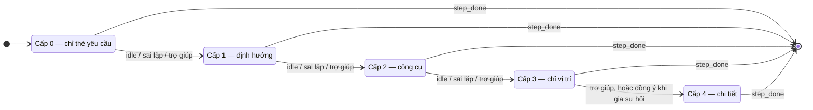

# Luật điều tiết gợi ý (hướng dẫn thích ứng)

**Task:** T3.4 · **Báo cáo:** mục 3.6 · **Trạng thái:** v1, chờ GVHD rà soát (T3.8)
**Code sẽ đặt ở:** `apps/desktop/src/tutor_desktop/agent/` (Teaching Agent, GĐ7)
**Đầu vào:** tín hiệu ([danh-muc-dieu-kien.md](danh-muc-dieu-kien.md) mục 3), sự kiện quan sát ([snapshot.md](snapshot.md) mục 7), kịch bản ([luoc-do-kich-ban.md](luoc-do-kich-ban.md))

## 1. Cơ sở lý thuyết → quy tắc thiết kế

| Cơ sở (đề cương 11.3) | Hệ quả cho luật gợi ý |
|---|---|
| **Tải nhận thức**: hiệu ứng chú ý phân tán (split-attention) | Gợi ý cấp 3 chỉ **ngay trên Excel** (overlay), không bắt học viên đối chiếu giữa hai cửa sổ. Thẻ yêu cầu ngắn, đặt gần vùng mục tiêu |
| **Tải nhận thức**: tránh chỉ dẫn dồn dập | **Mỗi lần chỉ một thông điệp.** Có thời gian giãn cách. Không lên tiếng khi học viên đang gõ hoặc đang làm đúng hướng (`on_track`) |
| **Hiệu ứng đảo ngược chuyên môn** (expertise reversal): hỗ trợ có ích cho người mới lại gây cản trở người đã thạo | **Giảm dần trợ giúp (fading)** theo từng nhóm kỹ năng: học viên đã làm tốt thì gia sư chờ lâu hơn mới gợi ý, và tự đưa tối đa cấp thấp hơn |
| **Khung phản hồi đa cấp** (Hattie & Timperley) | 4 cấp đi từ mức *quá trình / tự điều chỉnh* (cấp 1–2) xuống mức *nhiệm vụ* (cấp 3–4). Phản hồi theo mã lỗi là phản hồi mức nhiệm vụ, nói rõ **sai ở đâu** |
| **Gia sư theo vết thao tác** (model tracing, Cognitive Tutor) | Mỗi thay đổi ở vùng mục tiêu được kiểm ngay theo điều kiện của bước; lỗi được nhận diện **theo loại** (mã lỗi), không chỉ "đúng/sai" |
| **Không làm thay** (đề cương mục 9) | Cấp 4 (hướng dẫn chi tiết) **không tự hiện**: chỉ khi học viên bấm trợ giúp, hoặc gia sư **hỏi** "Bạn có muốn xem hướng dẫn chi tiết?" khi bế tắc lâu |

| Cấp | Tên | Mức phản hồi (Hattie & Timperley) | Ví dụ (b09 bước 2) |
|---|---|---|---|
| 0 | Chỉ thẻ yêu cầu | — | "Cột Số lượng hiển thị số nguyên, có dấu phân cách hàng nghìn" |
| 1 | Định hướng | Tự điều chỉnh / quá trình | "Cách số được hiển thị được điều chỉnh ở nhóm lệnh Number." |
| 2 | Gợi ý công cụ | Quá trình | "Nút Comma Style thêm dấu phân cách… dùng Decrease Decimal…" |
| 3 | Chỉ vị trí | Nhiệm vụ (ở đâu) | Overlay khoanh F10:F14 → nút Comma Style → nút Decrease Decimal |
| 4 | Hướng dẫn chi tiết | Nhiệm vụ (làm gì) | 3 thao tác đánh số + cách khác |

## 2. Trạng thái Teaching Agent giữ

**Theo bước** (đặt lại khi sang bước mới):

| Biến | Ý nghĩa |
|---|---|
| `level` | Cấp gợi ý cao nhất đã hiện ở bước này (0–4) |
| `fail_count` | Số lần kiểm chứng không đạt (sau một thay đổi ở vùng mục tiêu) |
| `last_codes` | Mã lỗi của lần không đạt gần nhất |
| `same_code_streak` | Số lần liên tiếp cùng một mã lỗi |
| `passed_checks` | Số điều kiện đang đạt (đo **tiến độ** trong bước) |
| `last_activity_at` | Lần cuối có thay đổi ở vùng mục tiêu hoặc chọn vùng mục tiêu |
| `last_message_at` | Lần cuối gia sư tự lên tiếng |
| `help_count` | Số lần bấm trợ giúp |

**Theo học viên, theo nhóm kỹ năng** (lưu ở Backend, đồng bộ về Desktop): `support_state ∈ {struggling, developing, proficient}`, mục 5.

## 3. Tham số

| Tham số | Mặc định | Kịch bản ghi đè được | Ghi chú |
|---|---|---|---|
| `IDLE_FIRST` | 60 s | `step.signals.idle_seconds` | Dừng bao lâu (bước chưa đạt) thì phát `idle` lần đầu |
| `IDLE_NEXT` | 45 s | — | Sau khi đã hiện một gợi ý, dừng thêm bao lâu thì tăng tiếp |
| `IDLE_MIN`, `IDLE_MAX` | 30 s, 180 s | — | Giới hạn sau khi nhân hệ số fading |
| `FAILS_TO_ESCALATE` | 2 | — | Số lần không đạt trong bước để tăng một cấp |
| `SAME_CODE_TO_ESCALATE` | 2 | — | Cùng mã lỗi liên tiếp → tăng ngay (`repeated_error`) |
| `MAX_AUTO_LEVEL` | 3 | `step.signals.max_auto_level` | Cấp cao nhất tự đưa ra |
| `OFFER_DETAIL_AFTER` | 2 lần `idle` hoặc 3 lần sai **ở cấp 3** | — | Khi đó hỏi "xem hướng dẫn chi tiết?", không tự hiện |
| `COOLDOWN` | 20 s | — | Khoảng cách tối thiểu giữa hai lần gia sư **tự** lên tiếng |
| `ESCALATE_GAP` | 15 s | — | Không tăng hai cấp liên tiếp trong khoảng này |

Mọi tham số nằm trong một file cấu hình của Desktop (`agent/policy.py`), **ghi vào nhật ký mỗi phiên** để phân tích thực nghiệm biết phiên đó chạy với tham số nào.

## 4. Luật (xét theo thứ tự ưu tiên, dừng ở luật đầu tiên khớp)

| # | Khi | Gia sư làm | Đổi `level` |
|---|---|---|---|
| R1 | `destructive_change` (vi phạm `global_checks`, hoặc mã lỗi thuộc `immediate_codes`) | Hiện phản hồi **ngay** (bỏ qua giãn cách), gợi ý Ctrl+Z | Không |
| R2 | Excel đang bận (sửa ô, mở hộp thoại) hoặc Excel không phải cửa sổ trước | **Hoãn** mọi thông điệp tự phát (trừ R1); không đếm thời gian `idle` | Không |
| R3 | `help_request` (học viên bấm trợ giúp) | Hiện cấp `level + 1` (tối đa 4). Đang ở 4 thì hiện lại cấp 4 | +1 |
| R4 | `step_done` | Khen ngắn ("Chính xác!"), ghi kết quả bước, cập nhật `support_state`, chuyển bước | Về 0 |
| R5 | `wrong_result`, có `feedback` cho mã lỗi **lần đầu** gặp ở bước này | Hiện phản hồi riêng theo mã lỗi | Không |
| R6 | `repeated_error` (`same_code_streak ≥ 2`) hoặc `fail_count` chạm bội số của `FAILS_TO_ESCALATE` | Hiện cấp `min(level + 1, MAX_AUTO_LEVEL)`, kèm phản hồi theo mã lỗi nếu có | +1 |
| R7 | `wrong_result` còn lại | Không lên tiếng thêm (đã có phản hồi trước đó), chỉ đánh dấu ô sai nhẹ trên cửa sổ gia sư | Không |
| R8 | `idle` (không hoạt động ≥ `IDLE_FIRST` khi `level = 0`, ≥ `IDLE_NEXT` khi `level ≥ 1`) | Hiện cấp `min(level + 1, MAX_AUTO_LEVEL)` | +1 |
| R9 | Đang ở `MAX_AUTO_LEVEL` và đạt `OFFER_DETAIL_AFTER` | **Hỏi**: "Bạn có muốn xem hướng dẫn chi tiết từng bước?" [Xem] [Tự làm tiếp] | Chỉ +1 nếu bấm Xem |
| R10 | `off_target` (sửa ngoài vùng mục tiêu, mở hộp thoại không liên quan) | Nhắc nhẹ một lần mỗi bước: "Bước này làm ở vùng được khoanh", kèm overlay vùng mục tiêu | Không |
| R11 | `on_track` (chọn đúng vùng, mở đúng hộp thoại), hoặc tiến độ tăng (`passed_checks` tăng) | **Không lên tiếng.** Đặt lại đồng hồ `idle`, đặt lại `same_code_streak` | Không |

**Giãn cách:** R5–R10 chỉ chạy khi `now - last_message_at ≥ COOLDOWN` và `now - lần_tăng_cấp_trước ≥ ESCALATE_GAP`; nếu chưa đủ thì giữ lại, xét lại ở `tick` sau. R1, R3, R4 không chịu giãn cách (học viên chủ động hoặc dữ liệu đang bị phá).

**Tăng cấp nghĩa là hiện cấp mới**, cấp cũ thu gọn lại (bấm để xem lại). Không hiện cùng lúc nhiều cấp (tránh dồn dập).

**Giảm mức hỗ trợ trong bước:** khi `passed_checks` tăng (học viên đang tiến bộ), R11 đặt lại đồng hồ và chuỗi lỗi, nên gia sư **lùi lại** thay vì tiếp tục tăng cấp. Overlay cấp 3 tự tắt khi học viên đã thao tác đúng vùng.

## 5. Giảm dần trợ giúp giữa các bước (fading theo kỹ năng)

Mỗi bước thuộc một hoặc vài nhóm kỹ năng (`step.skills` hoặc `exercise.skills`, lược đồ v1). Khi bước xong, chấm **điểm độc lập** của bước:

| Điểm | Khi |
|---|---|
| 2 | Xong mà `level = 0` và `fail_count ≤ 1` |
| 1 | Xong với `level ≤ 2` |
| 0 | Cần cấp 3–4, hoặc bỏ qua bước |

`support_state` của kỹ năng = trung bình điểm của **3 bước gần nhất** thuộc kỹ năng đó (kể cả từ bài trước):

| `support_state` | Điều kiện | Hệ số `idle` | `MAX_AUTO_LEVEL` | Khác |
|---|---|---|---|---|
| `struggling` | trung bình < 0,75 | × 0,75 | 3 | Lần sai đầu tiên: hiện phản hồi **kèm** cấp 1 |
| `developing` | còn lại | × 1,0 | 3 | Mặc định cho học viên mới |
| `proficient` | trung bình ≥ 1,5 | × 1,5 | **2** | Cấp 3–4 chỉ khi bấm trợ giúp (tránh đảo ngược chuyên môn) |

Thời gian `idle` hiệu lực = `clamp(IDLE × hệ_số, IDLE_MIN, IDLE_MAX)`. Ví dụ: `proficient` dừng 90 giây mới được nhắc, `struggling` 45 giây.

## 6. Ví dụ chạy luật (b09 bước 2, học viên `developing`)

| Thời điểm | Học viên làm | Tín hiệu | Luật | Gia sư hiện | `level` |
|---|---|---|---|---|---|
| 0 s | Sang bước 2 | — | — | Thẻ yêu cầu | 0 |
| 8 s | Chọn F10:F14 | `on_track` | R11 | (im lặng) | 0 |
| 15 s | Bấm Comma Style | `wrong_result` `wrong_decimals` | R5 | "Đã có dấu phân cách hàng nghìn rồi, nhưng số lượng không cần phần thập phân." | 0 |
| 20 s–80 s | Không làm gì | `idle` sau 60 s | R8 | Cấp 1: "…nhóm lệnh Number." | 1 |
| 95 s | Bấm Increase Decimal | `wrong_result` `wrong_decimals`, lần 2 cùng mã | R6 | Cấp 2: "Comma Style… Decrease Decimal…" | 2 |
| 110 s | Bấm Decrease Decimal 3 lần | `step_done` | R4 | "Chính xác!" → bước 3 | 0 |

Điểm bước = 1 (xong với cấp 2) → ghi vào kỹ năng `number_formatting`.

## 7. Ghi nhật ký (phục vụ thực nghiệm)

Mỗi lần gia sư lên tiếng ghi một sự kiện: `step_id`, `rule` (R1–R11), `signal`, `level` trước/sau, `error_codes`, thời điểm, và học viên phản ứng gì sau đó (đạt bước sau bao lâu). Dữ liệu này trả lời các câu hỏi của đề cương 5.2–5.3: **bước nào học viên hay vướng, cấp gợi ý nào hay được dùng**, gợi ý có giúp đạt bước không.

## 8. Kiểm thử (GĐ7)

Teaching Agent viết dưới dạng **hàm thuần**: `decide(state, signal, now, params) → (actions, new_state)`. Nhờ vậy test được mọi luật bằng chuỗi tín hiệu giả, không cần Excel: mỗi dòng của bảng mục 6 là một ca test.

## 9. Còn mở (hỏi GVHD ở T3.8)

1. Các ngưỡng (60 s, 2 lần sai, 20 s giãn cách) là **giả định ban đầu**. Thử nghiệm nhỏ (T9.1) sẽ điều chỉnh theo dữ liệu thật.
2. Có cho học viên **tắt** gia sư tự lên tiếng (chỉ hiện khi bấm trợ giúp) không? Nhóm thực nghiệm cần thống nhất một chế độ.
3. Có hiển thị cho học viên điểm/mức kỹ năng (`support_state`) không? Bản này: **không** hiển thị, chỉ dùng nội bộ.
