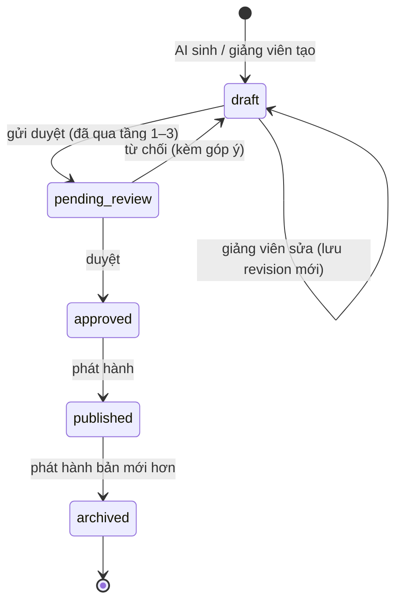

# Lược đồ kịch bản hướng dẫn JSON v1

**Task:** T3.2 · **Báo cáo:** mục 3.5 · **Trạng thái:** v1, chờ GVHD rà soát (T3.8)
**File:** [`schemas/tutor-script/v1/tutor-script.schema.json`](../../schemas/tutor-script/v1/tutor-script.schema.json) (JSON Schema draft 2020-12)
**Ví dụ:** [b09](../../schemas/tutor-script/v1/examples/b09-du-lieu-dang-so.json), [b22](../../schemas/tutor-script/v1/examples/b22-ham-tinh-tong.json), chuyển từ 2 kịch bản viết tay · **Test:** `packages/excel_core/tests/test_script_schema.py`

## 1. Vai trò

Kịch bản là **hợp đồng** giữa 3 phần:

| Bên | Làm gì với kịch bản |
|---|---|
| Backend | AI sinh ra → kiểm theo lược đồ → tự kiểm trên file đề/đáp án → lưu phiên bản |
| Web quản trị | Giảng viên xem, sửa, duyệt, phát hành |
| Desktop | Tải bản đã phát hành, chạy từng bước: kiểm chứng, bắt tín hiệu, hiện gợi ý |

Vì Desktop **không gọi AI**, mọi thứ Desktop cần để hướng dẫn phải có sẵn trong kịch bản: điều kiện kiểm chứng, vùng mục tiêu, gợi ý 4 cấp, phản hồi cho lỗi hay gặp.

## 2. Cấu trúc

```
kịch bản
├─ schema_version: "1"
├─ exercise        mã bài (= tutor_exercise_id trong file đề), tên, sheet làm bài, nhóm kỹ năng
├─ revision        số phiên bản kịch bản (Backend tăng)
├─ meta            nguồn gốc: ai / teacher / ai_edited, mô hình, thời điểm sinh
├─ references[]    trích dẫn: giáo trình (RAG), hướng dẫn trong file bài, ghi chú giảng viên
├─ global_checks[] điều kiện toàn bài (bảo vệ dữ liệu) → tín hiệu destructive_change
├─ steps[]         1–30 bước
│  ├─ id, title
│  ├─ task         THẺ YÊU CẦU: phải đạt gì, không nói cách làm (luôn hiện)
│  ├─ targets      cells[] (vùng target / source) + ui[] (nút Ribbon theo idMso)
│  ├─ checks[]     điều kiện kiểm chứng; bước đạt khi mọi điều kiện đạt
│  ├─ signals      tham số tín hiệu riêng: idle_seconds, immediate_codes, max_auto_level
│  ├─ operation    (tùy chọn) thao tác cấu trúc khi đề yêu cầu làm theo quy trình, mục 2.5
│  ├─ feedback[]   phản hồi riêng theo mã lỗi (error / info)
│  ├─ hints[4]     đúng 4 cấp, đúng thứ tự
│  └─ reference_ids[]
└─ completion      lời kết + đối chiếu tiêu chí của giảng viên với các bước
```

### 2.1. Gợi ý 4 cấp

Lược đồ dùng `prefixItems` để bắt buộc **đúng 4 phần tử, đúng thứ tự cấp**, mỗi cấp có hình dạng riêng:

| Cấp | Tên | Bắt buộc có | Hiện ở đâu |
|---|---|---|---|
| 1 | Định hướng | `text` | Cửa sổ gia sư |
| 2 | Gợi ý công cụ | `text` | Cửa sổ gia sư |
| 3 | Chỉ vị trí | `text` + `highlight[]` (vùng ô và/hoặc nút, **theo thứ tự**) | Cửa sổ gia sư + **overlay** trên Excel |
| 4 | Hướng dẫn chi tiết | `text` + `actions[]` (≤ 10 thao tác), `alternative` tùy chọn | Cửa sổ gia sư |

Khi nào hiện cấp nào: [luat-goi-y.md](luat-goi-y.md).

### 2.2. Vùng mục tiêu

- **Ô:** địa chỉ A1 **một vùng liền kề**, không tên sheet (`sheet` là trường riêng, mặc định `exercise.sheet`). Không cho địa chỉ ghép `A1:A5,C1:C5`, vì Excel lỗi trên máy định dạng Việt Nam (quy tắc code 2.3 mục 7). `role`: `target` (nơi phải làm) hoặc `source` (dữ liệu nguồn, chỉ đọc).
- **Giao diện:** `{"tab": "TabHome", "control": "CommaStyle"}`, là **AutomationId = idMso**, không phụ thuộc ngôn ngữ Office (T2.4). Danh mục: [danh-muc-idmso.md](../../spikes/t2-4-uia-ribbon/danh-muc-idmso.md). Lược đồ chặn tên có dấu cách (`"Comma Style"`) để tránh lưu nhầm tên hiển thị.

### 2.3. Điều kiện kiểm chứng

25 loại theo [danh-muc-dieu-kien.md](danh-muc-dieu-kien.md), mỗi loại có `$defs/check_<type>` riêng với tham số chặt (`additionalProperties: false`). Các quyết định chính:

| Quyết định | Lý do |
|---|---|
| Giá trị kỳ vọng mặc định `{"from": "solution"}`, hoặc `{"from": "range"}` | Không ghi cứng số liệu trong kịch bản (T2.6: AI bịa số) |
| `number_format` so theo ý nghĩa: `categories`, `decimals`, `thousands_separator` | Mã định dạng khác nhau giữa máy vi-VN và en-US (T1.2) |
| `alignment.horizontal` so theo **căn lề hiển thị**: ô General chứa số tính là `right` (chỉnh ở T4.4; trước đó ghi `["general","right"]` làm bước căn phải đạt sẵn trên đề, tầng 3 bắt được) | Excel tự căn phải số (T2.6) |
| `formula_consistent` ghi chú "luôn kèm `value_equals`" | R1C1 không bắt được lỗi `$` (đã kiểm chứng) |
| `sorted_by`, `autofilter`: cột theo **tiêu đề**, không theo chữ cái | Quy tắc code 2.3 mục 9 |
| `global_checks` chỉ nhận `data_unchanged`, `is_formula` | Điều kiện toàn bài chỉ để bảo vệ dữ liệu |
| Thêm `chart` (biểu đồ) | Phạm vi đề cương có biểu đồ; bài trung cấp sẽ dùng |
| `printed_to_pdf` | Chấm được nhờ sự kiện `WorkbookBeforePrint` (T2.4) |

### 2.4. Phản hồi riêng và tín hiệu

- `feedback[].code` là mã lỗi điều kiện trả về (`stored_as_text`, `absolute_reference`…). Desktop chọn câu phản hồi theo mã lỗi thay vì chỉ báo "sai". `severity: info` dùng cho trường hợp **chấp nhận nhưng nhắc nhẹ**.
- `signals.immediate_codes`: mã lỗi phải phản hồi **ngay**, không chờ (b09 bước 4: gõ đè lên công thức).
- `signals.max_auto_level`: cấp cao nhất gia sư tự đưa ra; cấp cao hơn chỉ khi học viên bấm trợ giúp (không làm thay).

### 2.5. Bước theo quy trình trong đề (`operation`, T5.9)

Có đề yêu cầu làm lần lượt các thao tác cấu trúc mà nhiều bước triệt tiêu nhau. Bài 06 ghi trong khối chữ của
hình vẽ: hiện cột E → chèn cột sau G → ẩn H → chỉnh độ rộng I, J → hiện H → xóa D, E, H. So file đề với file
đáp án chỉ còn "xóa 2 cột, đổi độ rộng". Bước ứng với một thao tác như vậy ghi thêm:

```json
"operation": { "action": "delete", "axis": "cols", "lines": ["D", "E", "H"] }
```

| Trường | Ý nghĩa |
|---|---|
| `action` | `hide`, `unhide`, `insert` (chèn **trước** `lines[0]`, `count` dòng/cột), `delete`, `resize` (`sizes` theo từng dòng/cột) |
| `axis`, `lines` | `cols` + chữ cột hoặc `rows` + số dòng, **theo bố cục lúc làm bước** (như đề ghi) |

Điều kiện của bước này ghi theo **trạng thái ngay sau thao tác**: `row_col_hidden`, `row_col_size`; chèn/xóa
thì kiểm vài ô tiêu đề nằm đúng chỗ bằng `value_equals` giá trị ghi sẵn (kể cả cột ngay trước chỗ chèn, để
bắt chèn nhầm chỗ). Tầng 3 và chấm thử dựng trạng thái mong đợi sau từng bước bằng cách làm lần lượt các thao
tác trên file đề (`excel_core.procedure`; đã đối chiếu Excel thật trên bài 06: giá trị, ô gộp, cột ẩn, độ rộng
khớp từng bước). Desktop không cần trường này: gia sư đi theo thứ tự bước, chấm trên Excel đang mở.

## 3. Kiểm tra kịch bản: 3 tầng

| Tầng | Kiểm gì | Ở đâu | Có từ |
|---|---|---|---|
| 1. Lược đồ | Cấu trúc, kiểu, tham số, đúng 4 cấp gợi ý | `excel_core.script.schema_issues()` (`jsonschema`) | T3.2 |
| 2. Tham chiếu chéo | id bước, id điều kiện không trùng; `reference_ids`, `completion.step_ids` trỏ tới cái có thật; `feedback.code` và `signals.immediate_codes` là mã mà điều kiện của bước (hoặc điều kiện toàn bài) **trả về được**; một mã chỉ một phản hồi; vùng/nút `highlight` nằm trong `targets` của bước; `expected.range` cùng kích thước vùng kiểm | `excel_core.script.cross_reference_issues()` | T4.5 |
| 3. Tự kiểm trên file | Mọi điều kiện **đạt trên đáp án**; mọi bước **chưa đạt trên đề** (điều kiện riêng lẻ đạt sẵn chỉ là cảnh báo: điều kiện giữ); điều kiện toàn bài đạt trên cả hai; **độ phủ diff** theo loại thay đổi (thay đổi định dạng số phải có điều kiện `number_format` phủ...); chữ gợi ý không có địa chỉ ô và số liệu không có trong bài. Kịch bản có `operation`: so trên trạng thái ngay trước/sau từng bước; làm hết các thao tác phải ra bố cục, dòng/cột ẩn như đáp án; thao tác vô nghĩa (hiện cột đang không ẩn) là lỗi | `excel_core.script.self_check_files()`, Backend (T5.5) | T4.5, T5.9 |

Kết quả tầng 3 chia **lỗi** (phải sửa trước khi gửi duyệt) và **cảnh báo** (giảng viên xem lại). Kiểm nhanh một kịch bản:

```powershell
.venv\Scripts\python -m excel_core.script kich-ban.json --starter de.xlsx --solution dap-an.xlsx
```

Hai kịch bản mẫu chạy qua cả 3 tầng trên file test cùng bố cục ([tests/fixtures](../../packages/excel_core/tests/fixtures/README.md)), độ phủ diff 100%. Tầng 3 đã bắt được lỗi thật của bản b09 đầu tiên: bước "căn phải" đạt sẵn trên file đề (lỗi T2.6), sửa bằng cách so căn lề hiển thị (mục 2.3).

Tầng 1 và 2 chạy ở **cả Backend (trước khi lưu) và Desktop (sau khi tải)**: Desktop không chạy kịch bản hỏng.

## 4. Phiên bản và phát hành

### 4.1. Phiên bản lược đồ (`schema_version`)

- Thêm trường **tùy chọn** hoặc loại điều kiện mới → vẫn là v1 (kịch bản cũ vẫn hợp lệ). Desktop cũ gặp loại điều kiện lạ thì **bỏ qua bước đó và báo** thay vì crash.
- Đổi tên, xóa, đổi nghĩa trường → **v2** ở thư mục mới `schemas/tutor-script/v2/`, không sửa đè (quy tắc code mục 4.1). Backend lưu kèm `schema_version` để biết đọc bằng lược đồ nào.

### 4.2. Phiên bản kịch bản (`revision`) và trạng thái



- **Mỗi lần lưu là một `revision` mới, không sửa đè.** Giữ được lịch sử "AI sinh gì, giảng viên sửa gì", là dữ liệu cho đánh giá chất lượng kịch bản AI so với giảng viên (đề cương 5.2: tỉ lệ bước phải chỉnh sửa).
- **Mỗi bài tại một thời điểm có tối đa một bản `published`.** Phát hành bản mới thì bản cũ chuyển `archived`.
- **Phát hành** = Backend nhúng `tutor_exercise_id` vào file đề (openpyxl, thuộc tính tùy chỉnh, T2.3) và mở cho Desktop tải.
- Desktop lưu bản đã tải kèm `revision`; khi có mạng thì hỏi Backend bản mới nhất (ETag). Phiên học đang dở **giữ nguyên revision cũ** tới khi xong, để nhật ký không bị trộn hai phiên bản.

Thiết kế bảng: [csdl.md](csdl.md) (`script_versions`). API: [openapi.yaml](openapi.yaml).

## 5. Chuyển từ kịch bản viết tay

| Kịch bản tay | JSON |
|---|---|
| Thẻ yêu cầu | `task` |
| Vùng mục tiêu: trang tính / tham chiếu / giao diện | `targets.cells` (`target` / `source`), `targets.ui` |
| Điều kiện kiểm chứng (a), (b), (c) | `checks[]`, mỗi ý một điều kiện |
| Tín hiệu kích hoạt | phần chung do Teaching Agent tự bắt (luật gợi ý); phần riêng ghi ở `signals` |
| Phản hồi riêng cho lỗi hay gặp | `feedback[]` theo mã lỗi |
| Bảng gợi ý cấp 1–4 | `hints[]`; cấp 3 *(Overlay)* → `highlight[]`; cấp 4 đánh số → `actions[]` |
| Điều kiện toàn bài | `global_checks[]` |
| Bảng "Hoàn thành bài" | `completion.criteria` |

Khi chuyển, đã sửa 2 điểm: (1) gợi ý **không ghi địa chỉ ô và số liệu cụ thể** trong chữ (vị trí đã có overlay chỉ), theo quyết định 8 của GĐ2; (2) bỏ phản hồi "dán kèm định dạng" của b09, vì chưa có điều kiện nào trả mã lỗi đó. Ghi nhận để thêm khi làm `checks/` (T4.4).

## 6. Còn mở

1. Câu hỏi cho GVHD trong 2 kịch bản tay (Thành tiền có phải bước bắt buộc; `0.00` có được chấp nhận; `=SUM(C9,D9,E9)`). Bản JSON đang theo phương án nháp.
2. ~~Thông báo lỗi của `jsonschema` với `oneOf` khó đọc.~~ Đã làm ở T6.4: Web kiểm kịch bản bằng Ajv trên cùng file lược đồ, kiểm riêng từng điều kiện theo đúng loại (`type`) để bỏ lỗi nhiễu của `oneOf`, đổi lỗi thành câu tiếng Việt kèm vị trí (ví dụ "Bước 2 › Gợi ý cấp 4 › Thao tác 1"); xem `apps/web/src/features/script-editor/scriptSchema.ts`. Mã lỗi cho ô chọn phản hồi lấy từ câu "Mã lỗi: …" trong mô tả `$defs/check_*`.
3. ~~Danh sách mã lỗi chuẩn cho từng loại điều kiện.~~ Đã chốt ở T4.4: [danh-muc-dieu-kien.md mục 6](danh-muc-dieu-kien.md#6-mã-lỗi-đã-chốt-khi-cài-đặt-t44); mô tả `$defs/check_*` trong lược đồ khớp với code (có test).
